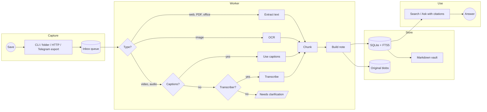
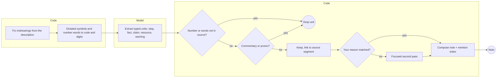

# InfoParser

Local-first knowledge capture. Save a link, file, video or note; get one searchable note that holds
the actual information (steps, numbers, names), not a description of it. Runs on your machine; models
are optional.

```
uv sync
uv run infoparser                                    # worker + dashboard on 127.0.0.1
uv run infoparser submit "<url or text>" --why "what I want from it"
uv run infoparser search "keywords"
uv run infoparser ask "question about what I saved"
```

Models, transcription and OCR are set in the dashboard's Settings tab or `config.toml`
(see `config.sample.toml`). With no model, a deterministic fallback still stores and searches.

## How it works



## Building a note

A small local model only finds the facts. Code checks and writes the note.



- Your reason for saving is used only if you wrote it. It is never guessed.
- A fact the source does not support is dropped. Incomplete beats wrong.
- On 14 synthetic cases with `gemma4:e4b`: recall 0.99, no blocking failures
  ([results](docs/note-pipeline.md)).

## Docs

[architecture](docs/architecture.md) · [pipeline](docs/pipeline.md) · [note pipeline](docs/note-pipeline.md) ·
[configuration](docs/configuration.md) · [limitations](docs/limitations.md)

Python 3.13. Some paths are unverified; read the limitations first.
