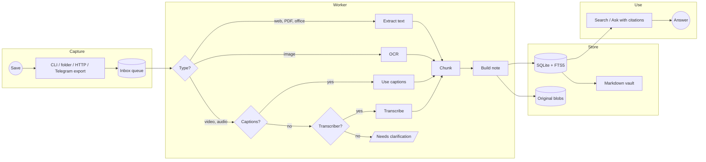
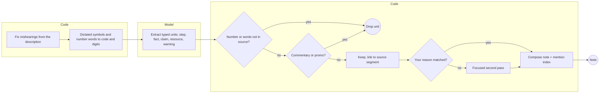

# Pith

**Pith is a personal knowledge base that runs on your own machine.** You save things you come across (a
link, a reel, a YouTube video, an article, a PDF, a screenshot, a voice note) and Pith turns each one into a
single searchable note that holds the actual information: the steps, numbers, names and resources, with a
pointer back to the source. Months later you can find one obscure detail, or ask a question and get an answer
built only from what you saved, with citations.

It is for the moment you see something worth keeping and do not want to file it. Share it, and it is handled.

## What it looks like

1. **Save** from wherever you are: share a link to your own Telegram bot from your phone, drop a file in a
   folder, paste into the dashboard, or use the CLI or an HTTP endpoint.
2. **Pith reads it**: fetches the page, pulls captions or transcribes audio, runs OCR on images, extracts
   text from PDFs and Office files. If it cannot read something, it tells you plainly and asks for help.
3. **It writes one note**: a small model extracts the facts, and code checks every one against the source.
   A fact the source does not support is dropped. Incomplete beats wrong.
4. **You return to your desk**: contextual groups keep mixed saved knowledge within reach. Open several
   groups, choose which belong in Focus, and read complete notes with sources. Search, Ask and purpose-based
   Shelves browse your real library; plain Markdown files also open in any editor.

## What it is, and is not

- **Yours.** One folder on your computer (SQLite plus plain files). No account, no cloud service, no relay.
  Even the Telegram bot is one you create and own.
- **Private by default.** Nothing leaves your machine unless you configure a cloud model and allow it.
- **Model-optional.** Works with no model at all (it still stores and searches). Tuned for a small local
  model (`gemma4:e4b` through Ollama); local servers and API keys plug in too.
- **Not a chat bot, a feed or a note-taking app.** It does not reply to what you send, and you do not
  need to file every capture: topics and shelf placement are automatic. Desk groups are yours to arrange.
- **Early (v0.1).** A single user on one machine. Some paths are not yet verified against the real services
  (Instagram/TikTok fetching, whisper transcription). Where it is going: the [roadmap](docs/roadmap.md).

## Quick start

```
uv tool install --editable .     # Python 3.13 + uv
pith init                        # then: pith (worker + dashboard + channels)
pith submit "<url or text>" --why "what I want from it"
pith search "keywords"
pith ask "question about what I saved"
pith stop                        # from another terminal; waits for a clean shutdown
```

Step by step, including the model and the Telegram bot: [getting started](docs/getting-started.md).

`pith run` opens the V5 product dashboard. Groups, membership, order and Focus are stored in your Pith
database; the first desk starts empty so you can choose your own contexts. New captures remain available
in Recently saved and All knowledge. Removing a group keeps its notes. After updating a running checkout,
restart Pith (`pith stop`, then `pith run`) to load the new built dashboard.

## How it works



## Building a note

A small local model only finds the facts. Code checks and writes the note.



- Your reason for saving is used only if you wrote it. It is never guessed.
- A fact the source does not support is dropped. Incomplete beats wrong.
- On 14 synthetic cases with `gemma4:e4b`: recall 0.99, no blocking failures
  (benchmark: `eval/notes`).

## Repository layout

```
src/pith/            the application (Python 3.13, standard library plus numpy)
  adapters/            ways in: Telegram bot, drop folder, HTTP endpoint, Telegram export, `pith setup`
  inbox/  jobs.py      the single ingress (Inbox.submit) and the job queue
  pipeline/            detect -> extract -> chunk -> note -> entities -> embed -> dedupe
  providers/           model backends (openai-compatible, Anthropic, CLI, whisper.cpp, tesseract, heuristic)
  retrieval/           search and ask
  store/               SQLite, migrations, content-addressed blobs
  dashboard/           HTTP server and API, plus static/index.html (generated, see below)
  cli.py  run_all.py   the `pith` command and the all-in-one runner
frontend/            dashboard source: React + TypeScript + Vite (own tests, e2e)
tests/               pytest suite; stubs/ are fake Telegram, Ollama, yt-dlp and so on
eval/                benchmark harness and datasets (notes, retrieval, dedupe, extraction)
skill/               host-agent skill (deferred to V2, see the roadmap)
docs/                the documents listed below
config.sample.toml   every setting, commented
```

**Two `index.html` files, one is generated.** `frontend/index.html` is the Vite entry (source).
`src/pith/dashboard/static/index.html` is the built dashboard, one self-contained file that the Python server
serves. It is committed so a Python-only install needs no Node. Do not edit it by hand: change `frontend/src`
and run `cd frontend && pnpm install && pnpm build`, which regenerates it. For live work, `pnpm dev` proxies
`/api` to a running `pith` (set `PITH_URL` and `PITH_TOKEN`).

Tests: `uv run pytest -q` for Python, `pnpm test` and `pnpm e2e` in `frontend/`.

## Docs

[getting started](docs/getting-started.md) · [what it can do](docs/capabilities.md) ·
[architecture](docs/architecture.md) · [pipeline](docs/pipeline.md) · [inbox contract](docs/inbox-contract.md) ·
[data model](docs/data-model.md) · [configuration](docs/configuration.md) · [backends](docs/backends.md) ·
[roadmap](docs/roadmap.md)
